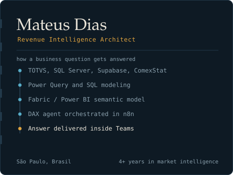
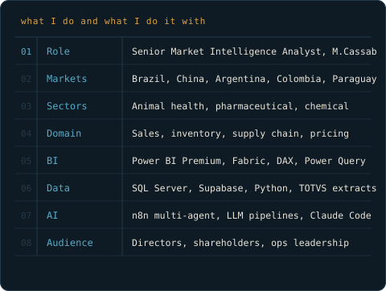

|  |  |
| --- | --- |

## Mateus Dias

**Market Intelligence · Power BI & Microsoft Fabric · AI automation for revenue teams**

I turn ERP and commercial data into systems that answer business questions on their own.
Day to day that means semantic models in Power BI and Microsoft Fabric, DAX and Python
pipelines, and n8n agents that let a director ask a question in Teams and get a real
number back. I work across Brazil, Argentina, Colombia and Paraguay, reporting into
directors and shareholders.

---

### What I build

- **Semantic models people actually trust.** Fabric and Power BI models over SQL Server
  and Postgres, with DAX that survives contact with real inventory, sales and supply
  chain data — lot-level aging, weighted average cost, churn, commissions.
- **Agents on top of those models.** n8n workflows that translate a plain-language
  question into a validated DAX query against the semantic model via the Power BI REST
  API, then render the answer inside Teams.
- **Market intelligence pipelines.** Python + LLM pipelines that pull public trade,
  procurement and commodity data, join it to internal history, and produce a decision
  document instead of a dashboard nobody opens.

---

### Selected work

| Project | What it does | Stack |
| --- | --- | --- |
| **Sales Booster** internal | Conversational agent that answers sales, inventory and stock-out questions in Teams by generating DAX against a Fabric semantic model | n8n, Power BI REST API, DAX, Azure Entra ID |
| **[Input price intelligence](#)** | Python pipeline joining historical and weekly price series for animal-nutrition inputs, producing an automated market report | Python, SQLite, Anthropic SDK, python-docx |
| **[SQL Quest](#)** | Gamified SQL learning platform with a content pipeline driven by schema and exercise definitions | Python, SQL, YAML |
| **[Garimpeii BR](#)** | Automated Instagram carousel publishing for a deals community, from offer intake to Graph API post | n8n, Groq API, htmlcsstoimage, Instagram Graph API |
| **Trade & procurement database** internal | Price intelligence base combining Compras.gov.br, IPEADATA and ANP series for sourcing and pricing decisions | Python, SQLite, public APIs |

---

### Stack

`Power BI` `Microsoft Fabric` `DAX` `Power Query (M)` `SQL Server` `T-SQL`
`Postgres / Supabase` `Python` `pandas` `n8n` `Power Automate` `VBA`
`Claude Code` `Codex CLI` `Git`

---

### Currently

Migrating a multi-agent BI assistant from a Postgres backend to a governed Fabric
semantic model, and studying AWS fundamentals and MLOps practices to put these
pipelines on firmer ground.

**Open to conversations about market intelligence, revenue operations and applied AI roles.**
[Reach me on LinkedIn](https://www.linkedin.com/in/mateus-jesusdias/).
